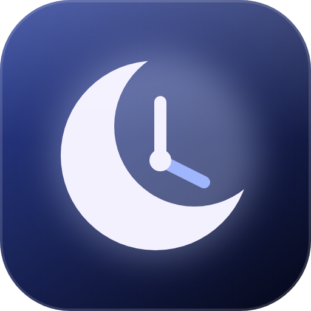

# Relógio Mond

Relógio de área de trabalho para Windows no estilo da skin Mond do Rainmeter: o dia da semana
gigante e espaçado, a data, a hora e o clima, e embaixo a música que está tocando, com capa,
título, artista, minutagem e um visualizador de barras que reage ao som de verdade.

Fica preso na área de trabalho: atrás de todas as janelas, visível no Win+D, sem aparecer na
barra de tarefas nem no Alt+Tab, e o clique passa direto para os ícones de baixo. Só duas partes
respondem ao mouse: a capa (passando por cima aparecem os botões de anterior, tocar/pausar e
próxima) e a barra da minutagem (clique ou arraste para pular para outro ponto da faixa, se o
player deixar). Ao trocar de faixa, a capa e o texto antigos saem deslizando e os novos entram do outro lado. Com a música pausada, a capa escurece e fica com um ícone de pause branco por cima.

Em português e em inglês (segue o idioma do Windows, ou escolha pelo menu).

## O que precisa

- Windows 10 ou 11
- [.NET 10 Desktop Runtime](https://dotnet.microsoft.com/download/dotnet/10.0)
- [Python 3](https://www.python.org/) (só para abrir o app sem janela de console)

## Instalar

1. Baixe o `.zip` da [release mais nova](https://github.com/FelipeWASD83/relogio-mond/releases/latest) e extraia onde quiser.
2. Rode `powershell -ExecutionPolicy Bypass -File ferramentas\criar-atalho.ps1 -Abrir`.

Pronto: o atalho "Relógio Mond" fica no Menu Iniciar e o relógio passa a abrir junto com o Windows
(dá para desligar pelo menu). Na primeira vez ele baixa a fonte Anurati, que é grátis só para uso
pessoal e por isso não vem no pacote.

## Como usar

Tudo fica no ícone do relógio perto do relógio do Windows (clique direito):

- **Idioma**: automático, português ou inglês
- **Mostrar o clima**, **Relógio de 24 horas**, **Iniciar com o Windows**
- **Editar configurações**: abre o `dados\config.json` no Bloco de Notas; salvou, o relógio muda na hora
- **Recarregar**, **Procurar atualização**, **Sair** (de fora do relógio, o mesmo "Sair" é `dotnet app\RelogioMond.dll --quit`)

No `config.json`:

| Campo | Para que serve | Padrão |
|---|---|---|
| `escala` | tamanho (1 = pensado para 3440x1440 a 125%) | `1.0` |
| `altura` | onde fica o centro do relógio, em fração da altura da tela (menor sobe) | `0.425` |
| `idioma` | `auto`, `pt` ou `en` | `auto` |
| `formato24h` | hora de 24 horas | `true` |
| `barras` | quantas barras no visualizador | `56` |
| `opacidade` | transparência do relógio inteiro | `1.0` |
| `clima`, `latitude`, `longitude` | o clima e de onde | Belo Horizonte |
| `iniciarComWindows` | abrir junto com o Windows | `true` |
| `pausarEmTelaCheia` | parar as barras com jogo ou vídeo em tela cheia | `true` |

A música vem do controle de mídia do Windows (o mesmo do pop-up de volume), então funciona com
Spotify, YouTube no navegador e qualquer player que apareça ali. As barras escutam o som que sai
da saída padrão; antivírus como o Kaspersky avisam isso como "usando o microfone" na primeira vez.

## English

Desktop clock for Windows in the style of the Mond Rainmeter skin: big spaced-out weekday, date,
time and weather, plus the song that is playing (cover, title, artist, time and a bar visualizer).
It sits on the desktop behind every window, stays visible on Win+D and lets clicks through, except
on the cover, which shows previous/play/next on hover. Install: download the latest release, then
run `ferramentas\criar-atalho.ps1 -Abrir`. Everything else is in the tray icon menu.

## Licença

Código sob a licença MIT (`LICENSE`). A fonte Quicksand vem junto sob a SIL Open Font License
(`fontes/OFL.txt`). A Anurati, de Emmeran Richard, é grátis para uso pessoal e não é distribuída
aqui. "Mond" é o nome da skin do Rainmeter que inspirou o visual; este projeto não tem ligação com
ela.
